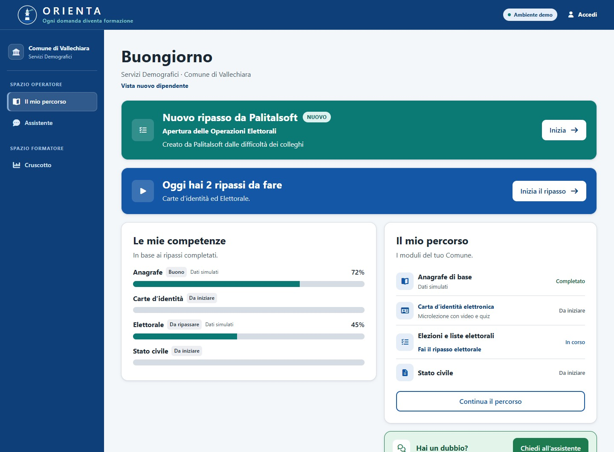
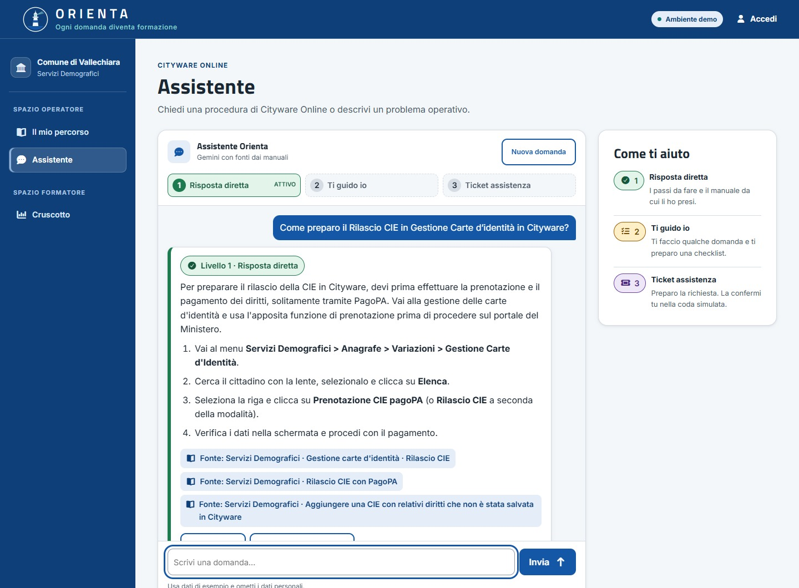
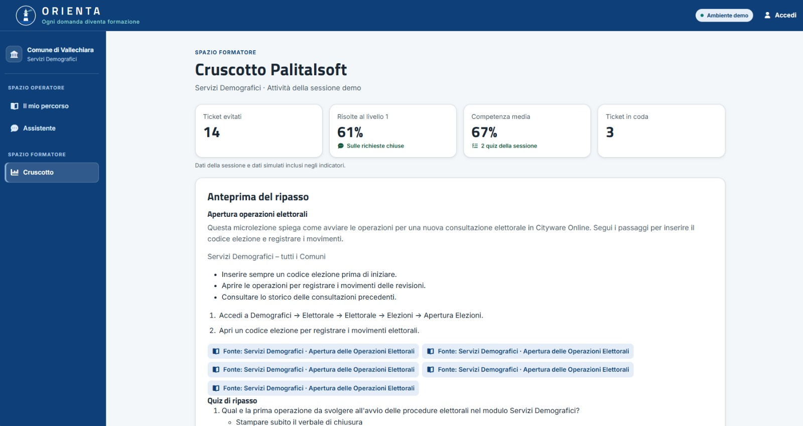

<p align="center">
  
</p>

<h1 align="center">Orienta</h1>
<p align="center"><strong>Ogni domanda diventa formazione.</strong></p>
<p align="center">
  Prototipo realizzato per l'hackathon <em>Responsible</em> · Palitalsoft × Unicam · novembre 2026
</p>

---

## Cos'è

Orienta è una web app per gli **operatori comunali che usano Cityware Online** di Palitalsoft. Fa tre cose:

1. **Forma** con microlezioni, mini-quiz e ripassi.
2. **Aiuta** quando l'operatore è bloccato: un assistente risponde usando i manuali ufficiali e mostra le fonti quando sono disponibili.
3. **Prepara un ticket simulato** quando serve assistenza. L'operatore rivede la bozza, già classificata per tipo e priorità, prima di inviarla alla coda demo.

Ogni domanda arriva nel **cruscotto dei formatori Palitalsoft**, che con un clic trasforma le difficoltà più frequenti in nuovi ripassi per tutti gli operatori. Meno ticket inutili, competenze misurabili e una formazione che migliora da sola.

```
Formazione → dubbio → Assistente (3 livelli) → risolto, oppure ticket classificato
     ↑                                                        ↓
     └────────── nuovo ripasso ← Cruscotto Palitalsoft ←──────┘
```

## Aree di lavoro

Nel menu **Area di lavoro** puoi passare tra Servizi Demografici, Area Economico-Finanziaria e Codice della Strada. La selezione determina i manuali dell'assistente, le microlezioni, i quiz e i dati del cruscotto.

- **Area Economico-Finanziaria:** atti di liquidazione e accertamenti PagoPA.
- **Codice della Strada:** inserimento verbali e gestione ricorsi.

## Screenshot

Schermate di riferimento della demo nei Servizi Demografici.

| Home dell'operatrice                | Assistente (livello 1)                          | Cruscotto Palitalsoft                         |
| ----------------------------------- | ----------------------------------------------- | --------------------------------------------- |
|  |  |  |

## L'assistente a tre livelli

| Livello                   | Quando                     | Cosa fa                                                                                                         |
| ------------------------- | -------------------------- | --------------------------------------------------------------------------------------------------------------- |
| **1 · Risposta diretta**  | La domanda è chiara        | Passi esatti con menu e pulsanti, più la fonte del manuale. Poi «Mi è servito» e mini-quiz.                     |
| **2 · Ti guido io**       | La domanda è generica      | Fa una domanda di chiarimento con scelte cliccabili. Mostra una checklist se sono disponibili passi da seguire. |
| **3 · Ticket assistenza** | Il problema non si risolve | Propone una bozza di ticket (tipo e priorità) e, quando disponibili, i controlli da fare prima dell'invio.      |

## Funzionalità

**Per l'operatore** · percorso formativo e competenze per area · microlezione CIE con video e quiz · ripassi assegnati da Palitalsoft · assistente con fonti consultabili · «Guida al primo accesso» in home.

**Per Palitalsoft** (`/palitalsoft`) · indicatori (ticket evitati, risolte al livello 1, competenza media, ticket in coda) · coda ticket per priorità con presa in carico e chiusura · mappa delle difficoltà e lacune nei manuali · **Crea ripasso**: anteprima generata dai manuali, poi assegnazione · completamento e punteggio dei ripassi assegnati.

> Gli indicatori del cruscotto uniscono i dati della sessione a dati **simulati**. Nome e Comune dell'operatrice (Laura, Comune di Vallechiara) sono inventati.

## Percorso della demo (circa 4 minuti)

1. **Home**: Laura vede percorso, competenze e ripassi.
2. **Assistente, livello 1**: «Come rilascio la carta d'identità elettronica?» → passi con fonte → «Mi è servito» → mini-quiz di 3 domande.
3. **Livello 2**: «Devo aprire una tornata elettorale. Quale procedura seguo?» → scelte cliccabili → risposta diretta dopo aver indicato il tipo di consultazione.
4. **Livello 3**: scegli la domanda suggerita sulla stampa bloccata delle liste sezionali → bozza di ticket (bug, priorità alta) → invio nella coda simulata.
5. **Cruscotto `/palitalsoft`**: coda ticket, mappa delle difficoltà, lacune nei manuali. **Crea ripasso** su «Apertura operazioni elettorali» → anteprima → **Assegna**.
6. **Ritorno alla home**: banner «Nuovo ripasso da Palitalsoft» → lezione e quiz → il cruscotto mostra completamento e punteggio. Il ciclo è chiuso.

Prima di ogni demo seleziona l'area da mostrare e usa **Ripristina questa area** in fondo al cruscotto. Dettagli in [docs/DEMO.md](docs/DEMO.md).

## Avvio rapido

**Requisiti:** Node.js ≥ 24.18, Git e MongoDB in esecuzione (locale o Atlas).

Su Windows, clona il repository con il supporto ai percorsi lunghi dei manuali.

```powershell
git clone -c core.longpaths=true https://github.com/gianlucainsero/myproject.git
cd myproject
```

Dalla radice del clone:

```bash
npm ci
cp env.template .env.example
```

Su PowerShell usa `Copy-Item env.template .env.example`. Genera un valore per `SESSION_SECRET` con `node -p "require('node:crypto').randomBytes(32).toString('hex')"` e copialo in `.env.example`. La connessione locale predefinita è `mongodb://localhost:27017/orienta`. Imposta `MONGODB_URI` se usi un'altra istanza. Per una demo in riserva lascia `GEMINI_API_KEY` vuota. Il template include segnaposto per inizializzare i client OAuth, Stripe e Twilio di Hackathon Starter. Per attivare gli accessi social configura le credenziali dei rispettivi fornitori.

```bash
npm start
```

Apri [localhost:8080](http://localhost:8080). `app.js` carica la configurazione da `.env.example`, un file locale escluso da Git.

### Modalità dell'IA

| Modalità           | Come si attiva                                          | Comportamento                                                                                                           |
| ------------------ | ------------------------------------------------------- | ----------------------------------------------------------------------------------------------------------------------- |
| **Gemini**         | `GEMINI_API_KEY` impostata                              | Risposte, microlezioni e quiz generati a partire dagli estratti dei manuali.                                            |
| **Riserva**        | Chiave assente, `AI_MOCK=1`, oppure Gemini non risponde | Risposte costruite dai manuali disponibili. Se serve un chiarimento, l'assistente propone le scelte o indica la lacuna. |
| **Demo scriptata** | `COMUNEPILOT_LIVE_AI=false`                             | Scenari predefiniti nei Servizi Demografici. Nelle altre aree l'assistente usa la riserva sui manuali dell'area.        |

Su PowerShell puoi forzare la riserva con `$env:AI_MOCK='1'; npm start`. Il template imposta `gemini-3.5-flash`. Se ometti `GEMINI_MODEL`, il codice usa `gemini-2.5-flash`. Con `node scripts/test-ai.js` puoi verificare modalità, tempi, fonti e livelli degli scenari, oltre a un quiz e una microlezione.

## Stack

Node.js · Express 5 · MongoDB/Mongoose · Pug · Bootstrap 5 + design token Orienta (`public/css/orienta.css`) · Google Gemini (API REST, senza SDK) · ricerca BM25 in memoria · Mocha/Chai/Playwright per i test. Il progetto parte da [Hackathon Starter](https://github.com/sahat/hackathon-starter) (MIT).

## Struttura del repository

```
ai/            modulo IA: ricerca, prompt, chiamata a Gemini, modalità di riserva
controllers/   logica delle pagine e delle API (comunepilot.js è il cuore di Orienta)
models/        schemi Mongoose (casi, ticket, quiz, ripassi assegnati)
views/         pagine Pug (views/comunepilot/ = interfaccia Orienta)
public/        CSS, immagini, video della microlezione, logo
data/          manuali Markdown e indici di ricerca
scripts/       build-index.js (indici), test-ai.js (prova del modulo IA)
test/          test automatici
docs/          documentazione (vedi sotto)
```

## Documentazione

| File                                                   | Contenuto                                                  |
| ------------------------------------------------------ | ---------------------------------------------------------- |
| [docs/ARCHITETTURA.md](docs/ARCHITETTURA.md)           | Come funziona: flusso, ricerca nei manuali, route, dati    |
| [docs/IA.md](docs/IA.md)                               | Strumenti di IA usati, funzionamento, **limiti** e privacy |
| [docs/DEMO.md](docs/DEMO.md)                           | Copione della demo e ripristino                            |
| [docs/FONTI.md](docs/FONTI.md)                         | Fonti, licenze e crediti                                   |
| [docs/design/](docs/design/)                           | Stile grafico e mockup                                     |
| [docs/HACKATHON-STARTER.md](docs/HACKATHON-STARTER.md) | README originale di Hackathon Starter (guide alle API)     |

## Test

Per i test che caricano la configurazione locale, copia `env.template` in `test/.env.test` e usa valori fittizi. Il file è escluso da Git. Su PowerShell usa `Copy-Item env.template test/.env.test`.

```bash
npm test               # test unitari (Mocha + copertura c8)
npm run lint-check     # ESLint + Prettier
npm run test:e2e:replay  # test end-to-end Playwright (fixture registrate)
```

## Team

| Persona             | Ruolo                                                                      |
| ------------------- | -------------------------------------------------------------------------- |
| **Gianluca Insero** | Prodotto, strategia e pitch                                                |
| **Mattia**          | Design, identità visiva (logo, palette, diagrammi), slide e documentazione |
| **Flavius**         | Sviluppo della web app                                                     |

Gli strumenti di IA usati nello sviluppo sono dichiarati in [docs/IA.md](docs/IA.md). Le scelte di prodotto e il ragionamento sono del team.

## Licenza e avvisi

Il **codice** è rilasciato con licenza [MIT](LICENSE) (include il lavoro di Sahat Yalkabov e dei contributori di Hackathon Starter). I **manuali Cityware Online** in `data/manuali/` e il **logo Palitalsoft** appartengono a Palitalsoft e sono qui usati solo per l'hackathon: **non sono coperti dalla licenza MIT**. Vedi [docs/FONTI.md](docs/FONTI.md).

Orienta è un **prototipo**: usa dati inventati e non va usato con dati personali reali dei cittadini. Segnalazioni di sicurezza: [SECURITY.md](SECURITY.md).

---

_English summary: Orienta is a prototype web app for municipal operators using Palitalsoft's Cityware Online. It combines micro-lessons and quizzes, an AI assistant grounded in the official manuals, with citations when available and a simulated ticket queue for issues that need support, and a dashboard that turns frequent questions into new training for everyone. Built with Node.js, Express, MongoDB and Google Gemini for the Palitalsoft × Unicam hackathon._
